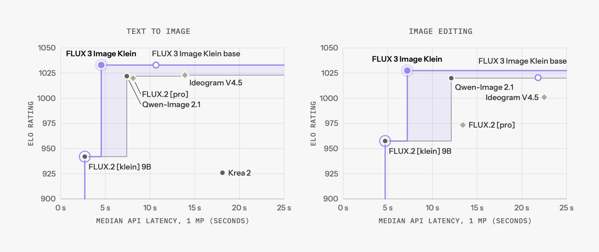
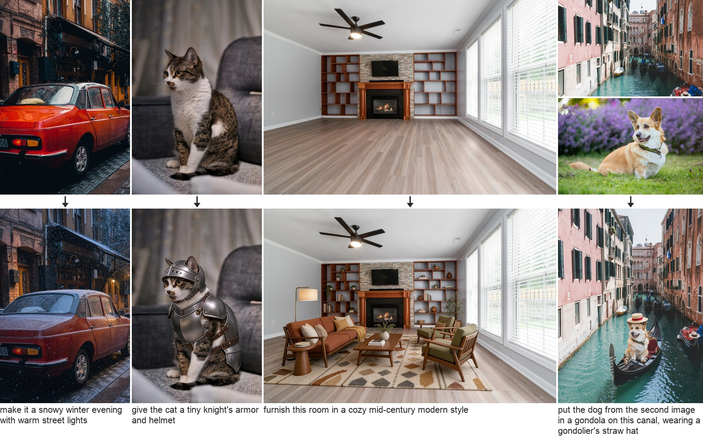
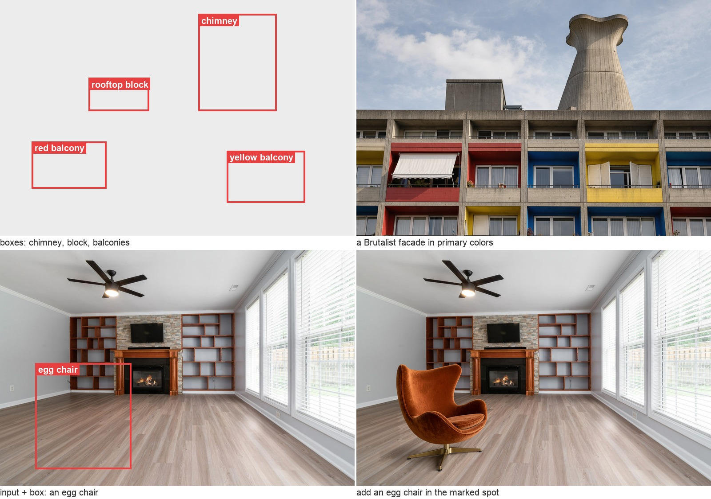
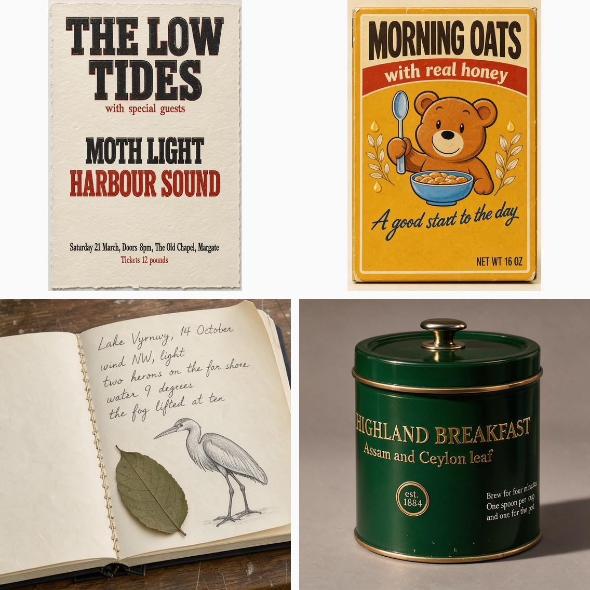
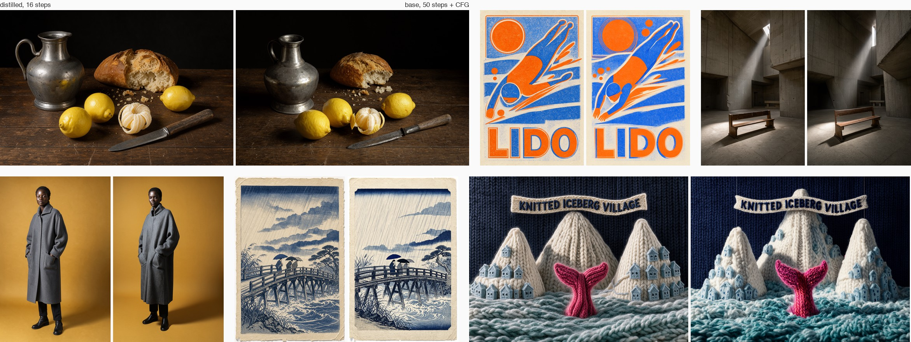
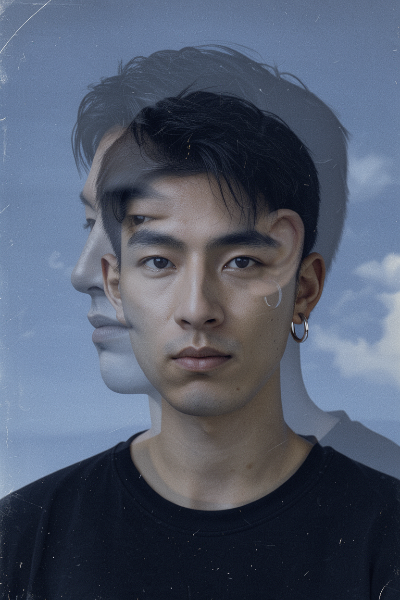
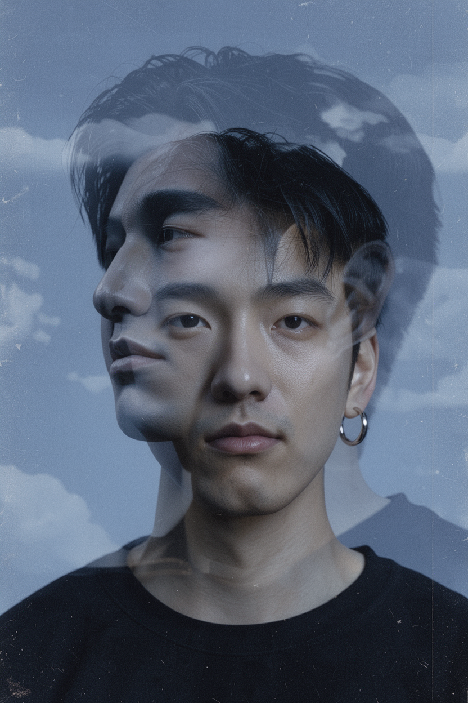
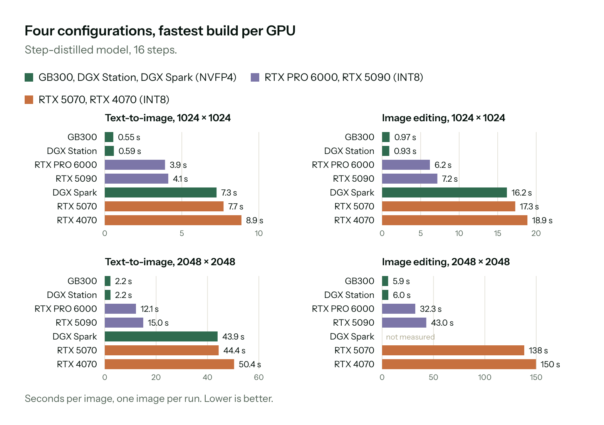
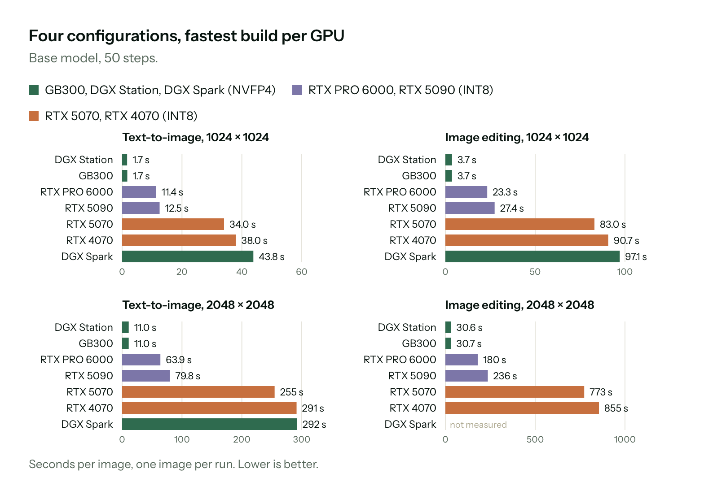

# FLUX 3 Image Klein

<p align="center">
<a href="https://bfl.ai/models/flux-3-image-klein">Model page</a> •
<a href="https://huggingface.co/black-forest-labs/flux-3-image-klein">Weights</a> •
<a href="#demo">Demo</a>
</p>

This repository contains the reference inference code for [FLUX 3 Image Klein](https://bfl.ai/models/flux-3-image-klein), the 5.6B open weights image model
from [Black Forest Labs](https://bfl.ai): text-to-image, editing with up to 10 reference images, and layout control
with bounding boxes, through one model.


## Performance

Leads in quality and speed among open weights models: the Pareto frontier of Elo rating against latency, for text-to-image and for image editing.



<sub>Elo from our internal evaluations; median API latency for a 1 MP image.</sub>

## Model overview

| Name | Steps | Guidance | Resolution | Text-to-image | Editing (up to 10 references) | Bounding boxes | License |
| :--- | :---: | :---: | :---: | :---: | :---: | :---: | :---: |
| [FLUX 3 Image Klein](https://huggingface.co/black-forest-labs/flux-3-image-klein) | 16 | none | up to 4K | ✅ | ✅ | ✅ | [FLUX Kommunity License](https://huggingface.co/black-forest-labs/flux-3-image-klein/blob/main/LICENSE.md) |
| [FLUX 3 Image Klein Base](https://huggingface.co/black-forest-labs/flux-3-image-klein-base) | 50 | CFG 3.5 | up to 4K | ✅ | ✅ | ✅ | [FLUX Kommunity License](https://huggingface.co/black-forest-labs/flux-3-image-klein/blob/main/LICENSE.md) |
| [FLUX 3 Image Klein Prompt Upsampler](https://huggingface.co/black-forest-labs/flux-3-image-klein-pup) | | | | | | | [Apache 2.0](https://huggingface.co/datasets/choosealicense/licenses/blob/main/markdown/apache-2.0.md) |

## Which model should I use?

| Need | Recommended |
|------|-------------|
| Generation and editing, self-hosting | FLUX 3 Image Klein (distilled): the same model in 16 steps without CFG, about 6x faster |
| Fine-tuning, LoRA training, research | FLUX 3 Image Klein Base |
| An 8 GB GPU (RTX 3070 class) | the int8 files in [ComfyUI](#run-it-elsewhere) |

### Text-to-image examples


### Editing examples



### Layout examples



### Typography



### Base vs distilled

Same prompt, same seed: distilled (16 steps) left, base (50 steps, CFG) right. On one H200 at 1 MP: about 3 s against 12 s per image.



## Local installation


To run FLUX 3 Image Klein in BF16 and FP8:

```bash
python3.12 -m venv .venv && . .venv/bin/activate
pip install -e . --extra-index-url https://download.pytorch.org/whl/cu130
```

To run FLUX 3 Image Klein in BF16, FP8 and NVFP4 (NVFP4 needs a Blackwell GPU):

```bash
python3.12 -m venv .venv && . .venv/bin/activate
pip install -e '.[nvfp4]' --extra-index-url https://download.pytorch.org/whl/cu130 --extra-index-url https://flashinfer.ai/whl/cu130
```

The installation was tested on B200; see [Memory](#memory) for other GPUs.

### Weights

The fast model alone, 22 GB:

```bash
hf download black-forest-labs/flux-3-image-klein --local-dir weights/flux-3-image-klein --exclude 'variants/*'
hf download Falconsai/nsfw_image_detection --local-dir weights/nsfw-classifier
```

Everything, 84 GB:

```bash
hf download black-forest-labs/flux-3-image-klein-base --local-dir weights/flux-3-image-klein-base
hf download black-forest-labs/flux-3-image-klein --local-dir weights/flux-3-image-klein
hf download black-forest-labs/flux-3-image-klein-pup --local-dir weights/pup
hf download Falconsai/nsfw_image_detection --local-dir weights/nsfw-classifier
```

`WEIGHTS_DIR` points at another root (default `./weights`). The quantized DiTs live under `variants/fp8r` and
`variants/nvfp4` in each repository; the text encoder and autoencoder ship with both.

## Run the CLI

### Text to image

```bash
python scripts/cli.py "A man walking with his dog, afternoon sun" --model distilled --no-pup --out out.png --seed 7
```

Each generated image comes with a `.json` containing the prompt, size, number of steps, guidance value and seed; [examples/README.md](examples/README.md) has the command behind every
image in this README.

### Edit an image

```bash
python scripts/cli.py "put a red bandana around the dog's neck" --image examples/inputs/3.png --out out.png --seed 22
```

Up to 10 references; the first one sets the output size:

```bash
python scripts/cli.py "print the dog from the second image onto the mug" \
  --image examples/inputs/2.png --image examples/inputs/3.png --out out.png --seed 23
```

### Place elements with bounding boxes

```bash
python scripts/cli.py "hot-air balloons over a green valley at sunrise" \
  --boxes examples/inputs/balloons_boxes.json --out out.png --seed 1
```

Format in [Bounding boxes](#bounding-boxes).

### Smaller GPUs

```bash
python scripts/cli.py "..." --model distilled --fp8 --no-pup --out out.png
```

`--fp8` (Ada, Hopper, Blackwell) or `--nvfp4` (Blackwell) load the quantized DiTs; `--no-pup` skips the upsampler. Numbers in [Memory](#memory).

### From Python

```python
from PIL import Image

from flux3.generate import Models, generate
from flux3.pipeline import WEIGHTS, dit_path

models = Models({"distilled": str(dit_path("distilled"))}, pup=str(WEIGHTS / "pup"), pup_memory=0.35)

image, record = generate(models, "distilled", "a red bicycle leaning on a white wall", images=[], seed=1)
image.save("bicycle.png")

image, record = generate(models, "distilled", "put a red bandana around the dog's neck",
                         images=[Image.open("examples/inputs/3.png")], seed=22)
image.save("bandana.png")
```

`Models` loads once; `generate` also takes `boxes`, `width`, `height`, `steps`, `guidance`, `pup`, `safety`.

## Demo

```bash
python scripts/app.py            # http://127.0.0.1:7860; --share for a public link
```

Three tabs: **Layout** (draw boxes, type what goes in each), **Text to image**, **Edit**. `--offload`, `--fp8`,
`--nvfp4` and `--no-pup` apply as in the CLI.

## Prompt upsampling

The upsampler ([black-forest-labs/flux-3-image-klein-pup](https://huggingface.co/black-forest-labs/flux-3-image-klein-pup),
a 9B vision-language model fine-tuned from Qwen3.5-9B) expands a short request into the detailed prompt the model
works best with, before it reaches the text encoder. On by default; `--no-pup` sends the prompt as typed.

| input prompt | what the model saw |
|---|---|
| `double exposure portrait: a young East Asian man facing the camera, a larger translucent profile of him facing left layered over him, muted blues, film grain, silver hoop earring` | "Digital double-exposure portrait in a muted blue monochrome palette, framed as a head-and-shoulders composition with visible 35mm film grain. Centered in the foreground, a young East Asian man in his twenties faces the camera directly ... a polished silver hoop earring hangs from his left ear. His face remains sharply defined beneath a larger translucent profile of the same man layered across it, facing left ..." (214 words, [examples/upsampling/double_exposure_s1.json](examples/upsampling/double_exposure_s1.json)) |

<p align="center"> </p>

```bash
python scripts/cli.py "double exposure portrait: a young East Asian man facing the camera, a larger translucent profile of him facing left layered over him, muted blues, film grain, silver hoop earring" \
  --model distilled --width 832 --height 1248 --seed 1 --out out.png
```

Upsample without generating:

```bash
python -m flux3.pup --prompt "double exposure portrait: a young East Asian man facing the camera, a larger translucent profile of him facing left layered over him, muted blues, film grain, silver hoop earring" --out prompt.txt
```

## Bounding boxes

`boxes.json` is a list of boxes, `[y_min, x_min, y_max, x_max]` in 0 to 1, top-left origin:

```json
[{"id": "obj_1", "desc": "a red hot-air balloon", "bbox": [0.08, 0.10, 0.45, 0.42]},
 {"id": "obj_2", "desc": "a lighthouse on a cliff", "bbox": [0.30, 0.60, 0.95, 0.90]}]
```

For edits, a box is `{"id", "desc", "from": "ref_image_0" | "target", "src_bbox", "tgt_bbox"}`: where it is in
a reference, where it goes in the output, or both.

## Run it elsewhere

| | |
|---|---|
| [ComfyUI](https://github.com/comfyanonymous/ComfyUI) | [black-forest-labs/flux-3-image-klein-comfy](https://huggingface.co/black-forest-labs/flux-3-image-klein-comfy): bf16, int8 and NVFP4 files for both models. The int8 files run on 8 GB GPUs such as the RTX 3070 |
| [Diffusers](https://github.com/huggingface/diffusers) | from launch day |
| [SGLang](https://github.com/sgl-project/sglang), [vLLM](https://github.com/vllm-project/vllm) | from launch day |

## Benchmarks

Seconds per image, one image per run, fastest build per GPU: NVFP4 on Blackwell data-center and DGX parts, int8 on
the RTX cards (the ComfyUI files, [Run it elsewhere](#run-it-elsewhere)).

### FLUX 3 Image Klein, 16 steps



### FLUX 3 Image Klein Base, 50 steps



## Memory

Peak GPU memory (nvidia-smi) on a B200 at 1024x1024, text-to-image and an edit with one reference:

| | bf16 | `--fp8` | `--nvfp4` |
|---|---|---|---|
| `cli.py --model distilled --no-pup` | 31 GB | 26 GB | 25 GB |
| `cli.py --model base --no-pup` | 31 GB | 29 GB | 26 GB |

The upsampler reserves `--pup-memory` of the GPU (default 0.35). `--fp8` needs Ada, Hopper or Blackwell; `--nvfp4`
needs Blackwell and the `[nvfp4]` install, not with `--offload`.

This code has no int8 path. On GPUs without FP8 (RTX 30 series and older) use the int8 files from [black-forest-labs/flux-3-image-klein-comfy](https://huggingface.co/black-forest-labs/flux-3-image-klein-comfy) in ComfyUI.

## Safety

Off by default; `--safety` (CLI) or **Advanced, Safety checks** (demo). Prompts, reference images and outputs are
checked for copyrighted characters, brands and public figures (VLM) and for NSFW content (classifier); anything flagged
is refused. Saved images carry EXIF tags (`Software: AI generated`, `Make: Black Forest Labs`).

## License

The code in this repository is released under the [Apache License 2.0](LICENSE). The FLUX 3 Image Klein weights are under the [FLUX Kommunity License](https://huggingface.co/black-forest-labs/flux-3-image-klein/blob/main/LICENSE.md); the prompt upsampler is Apache 2.0.

## Citation

```bib
@misc{flux-3-image-klein-2026,
    author={Black Forest Labs},
    title={{FLUX 3 Image Klein}},
    year={2026},
    howpublished={\url{https://bfl.ai/models/flux-3-image-klein}},
}
```
